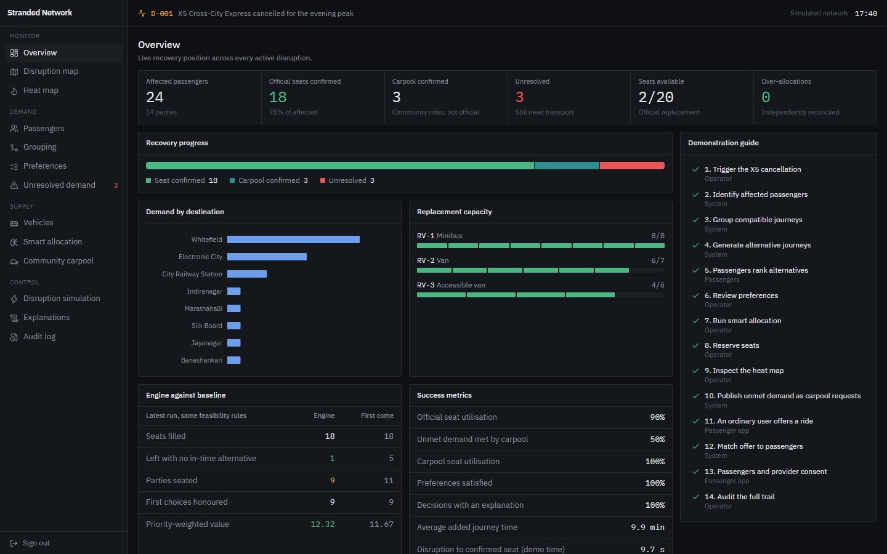
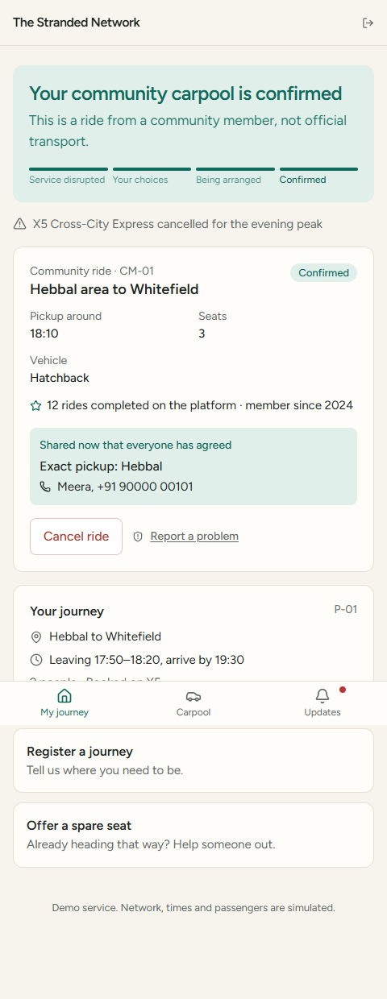

# The Stranded Network

**Dynamic travel recovery, passenger coordination and community carpooling.**

When a service is cancelled, journey planners help each passenger alone, and they all compete for the same few seats. The Stranded Network treats a disruption as one shared problem of passengers and capacity. It groups compatible journeys, collects what passengers actually want, allocates replacement seats fairly and explains every decision. When official seats run out, it turns the remaining demand into anonymous ride requests that ordinary people already heading that way can fill.

To run it, see [SETUP.md](SETUP.md).

| Operator console | Passenger app |
| --- | --- |
|  |  |

## Two separate dashboards

| | Passenger app (`/app`) | Operator console (`/operator`) |
| --- | --- | --- |
| **For** | Travellers and community drivers | Transport control room staff |
| **Feel** | Warm, plain language, one column, mobile first | Dark, dense, monospaced figures |
| **Sections** | Status and tracking, journey registration, disruption details, compare and rank alternatives, assigned transport, carpool requests, offer a ride, match and consent, updates | Overview, disruption map, heat map, passengers, grouping, preferences, unresolved demand, vehicles, smart allocation, carpool monitoring, simulation, explanations, audit log |

Both use the same API and database. Access rules are enforced by the backend, and changes reach every open dashboard over a WebSocket.

## How a recovery works

```text
Cancellation -> affected passengers -> grouping -> alternatives
                                                       |
                       passengers rank their options in the app
                                                       |
            feasibility filter -> priority score -> optimiser -> PROPOSAL
                                                                    |
                               operator approves -> atomic reservation -> SEAT
                                                                    |
                 no seat? -> anonymous listing -> ordinary user offers a ride
                                                                    |
                         passengers accept -> driver confirms -> CARPOOL
```

The app keeps these states separate, and a passenger always knows which one applies:

`Suggested journey` → `Passenger preference` → `Operator-approved` → `Confirmed seat`, or `Community offer` → `Confirmed carpool`

Choosing an option never reserves anything. Engine proposals are not shown to passengers at all, because nothing has been promised yet.

## The rules that can't be broken

| Guarantee | How it is enforced |
| --- | --- |
| Never over-allocate a vehicle | Seats are taken by one conditional `UPDATE ... WHERE available_seats >= n`, never read and written back. Database `CHECK` constraints reject anything outside `0..capacity`, even if application code is wrong. |
| Simultaneous confirmations are safe | Tested with 20 threads racing for 5 seats: exactly 5 win. Six threads confirming one allocation: exactly one wins. |
| One seat per party | A partial unique index allows one active allocation per journey. A party with a confirmed carpool can't be given an official seat as well. |
| Accessibility is never traded away | It is a feasibility constraint, not a score. No weighting, preference or override can put a wheelchair user on an unsuitable vehicle. |
| Confirmed bookings are never silently changed | Disruptions move them to `needs_review` with a stated reason, the passenger is told, and an operator decides. Every change is audited. |
| Carpool is independent of official transport | It has its own seat accounting and statuses, and never creates an allocation or touches vehicle seats. |
| No consent, no contact details | Names, phone numbers and exact pickups are released only after the passengers and the driver have all confirmed, and only to those people. |
| The heat map is operator-only and aggregated | Authorisation sits on the router, so no route can omit it. Data is snapped to about 1 km cells on the server, so raw coordinates and identities never reach the browser. |

An independent check reconciles seat accounting on demand and shows the result on the Overview page. Over-allocations should always read 0.

## The algorithms

**Grouping** (`engines/grouping.py`). Complete-linkage agglomerative clustering, so every pair in a group must be compatible, not just a chain of neighbours. Route overlap uses *directed* road edges. Two passengers going to City Railway Station from opposite sides of the city share nothing, and neither do two passengers on the same road in opposite directions. Also weighs pickup distance, shifted departure windows and requirements.

**Feasibility** (`engines/feasibility.py`). Checks seats, accessibility, open route, pickup and destination served in the right order, departure window and arrival deadline. This is separate from prioritisation: a vehicle that fails any check is not a candidate.

**Prioritisation** (`engines/priority.py`). Weights are configurable in the console, and changes are audited with a reason.

```text
priority = 0.30 waiting + 0.30 urgency + 0.20 scarcity + 0.10 group + 0.10 preference
```

Every decision records its breakdown and a plain-English explanation.

**Allocation** (`engines/allocation.py`). OR-Tools CP-SAT solves a multiple-knapsack problem. It maximises priority-weighted seats, so each passenger counts equally, and adds a bonus for keeping groups together. It uses a fixed seed and one worker, so results are reproducible. If OR-Tools is missing, a deterministic greedy solver takes over.

**Carpool matching** (`engines/carpool.py`). Independently checks route, detour limit, timing, arrival deadline, vehicle suitability and seats. A knapsack fills the offer with whole parties, and parties are never split.

**Re-routing** (`engines/disruption.py`). Handles cancellations, delays, closures, lost vehicles and capacity cuts through one pipeline. Closed roads leave the graph, so services and vehicles divert automatically or report that they can't get through.

## Demonstration results

The scenario is reproducible: 24 passengers in 14 parties, and 3 vehicles with 8, 7 and 5 seats (20 in total). A first-come baseline is recomputed on every engine run under the same feasibility rules.

| Latest run | Engine | First come |
| --- | --- | --- |
| Seats filled | 18 | 18 |
| **Passengers left with no in-time alternative** | **1** | **5** |
| Parties seated | 9 | 11 |
| Priority-weighted value | 12.32 | 11.67 |

Read these with care:

- **The scenario was designed to show this difference.** It includes a late-reporting party of 4 with no walk-up alternative, which is exactly the case a queue handles badly. This is an illustration, not evidence about real-world performance.
- **The engine doesn't win on every measure.** First come seats more parties, because small parties fill gaps. The engine chooses to keep the party with no other way home together.
- **Two seats stay empty on purpose.** Nobody left can use them, and the engine won't force a bad fit.

After official allocation 6 passengers remain. One carpool offer takes 3 of them, leaving 3 unresolved and visible to the operator.

## What is real and what is simulated

| Real | Simulated |
| --- | --- |
| Authentication, roles, password hashing (scrypt) and JWT sessions | The transport network: fictional services, timetables and travel times, labelled in the UI |
| Database, transactions and constraints | All passengers, vehicles and drivers (fictional people) |
| Grouping, allocation, carpool matching and rerouting | The clock, fixed at 17:40 on a simulated service day |
| OR-Tools optimisation | Passenger responses, only when the operator presses *Simulate passenger responses* (marked as simulated in the audit log) |
| WebSocket live updates | Notifications are in-app only, with no SMS or push |
| OpenStreetMap tiles, the only external service | Stop positions are approximate real Bengaluru locations |

## Known limitations

- **Routing is simulated only.** There is no live routing or transport feed. Travel times come from a hand-built road graph, and map lines are schematic rather than road alignments.
- **Map tiles need internet.** Without it the map background is blank, but overlays, the heat layer and the rest of the app still work.
- **PostgreSQL is untested.** The schema and queries are written to be portable, but everything was run on SQLite.
- **Community drivers are not verified.** The only trust indicators are completed rides and membership date, and the app says so plainly. A real launch would need identity checks, insurance and legal review.
- **Walk-up services have no modelled capacity.** The app recommends them but says a seat isn't guaranteed.
- **Demo mode is insecure by design.** It exposes a quick-login list and a reset. Set `DEMO_MODE=false` and a real `JWT_SECRET` anywhere else. The server refuses to start with the default secret once demo mode is off.

## Tests

172 automated tests, plus a scripted browser walkthrough of the full demo during development.

| File | Covers |
| --- | --- |
| `test_capacity.py` | Concurrent reservations, database constraints, recheck at confirmation, party integrity |
| `test_grouping.py` | Directionality, timing, complete linkage, determinism |
| `test_prioritisation.py` | The formula, explanations, accessibility, overrides, baseline comparison |
| `test_preferences.py` | Preference is not booking, ranking, invalidation, ownership, state separation |
| `test_carpool.py` | Seat limits, detour, timing, consent order, privacy, double-seat prevention |
| `test_disruption.py` | All five disruption types, flagging, reassignment, seat consistency |
| `test_access_and_heatmap.py` | Every operator route against anonymous and passenger users, token forgery, heat map aggregation |
| `test_end_to_end.py` | The complete 13-step demonstration through the HTTP API |

The critical guards were also mutation-checked: each was deliberately broken to confirm a test fails. That exercise found one test passing for the wrong reason, which was then fixed.

## Project layout

```text
backend/
  app/
    engines/    grouping, feasibility, priority, allocation, alternatives,
                disruption, carpool, network, reporting
    routers/    passenger, carpool, operator (router-level auth), demo, common
    models.py   data model and capacity constraints
    seed.py     the demonstration scenario
  tests/
frontend/src/
  operator/     control room console (IBM Plex, dark)
  passenger/    passenger app (Figtree, light)
  lib/          API client, live updates, Leaflet helpers
```

Stack: React, TypeScript, Vite, Tailwind CSS, Lucide, Recharts, Leaflet and leaflet.heat, with Python, FastAPI, Pydantic, SQLAlchemy, SQLite and OR-Tools.
